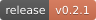
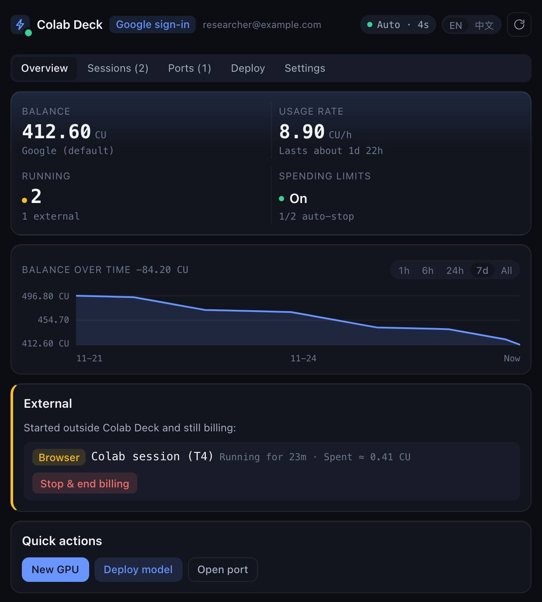

<div align="center">


# Colab Deck (`colab-mcp`)

**Colab GPUs from your sidebar, with a spending limit.**

Colab Deck starts, watches, and stops Colab sessions, forwards ports, and deploys GGUF models without opening a notebook. Auto-stop and spending limits keep an idle GPU from draining your balance overnight.

[Homepage](https://colabdeck.eatingdream.dev) · English | [简体中文](README.zh-CN.md) · [Releases](https://github.com/eatingDream-antigravity-plugins/colab-deck/releases) · [AI Guide](docs/ai-guide.md) · [`llms.txt`](llms.txt)

[](https://github.com/eatingDream-antigravity-plugins/colab-deck/actions/workflows/ci.yml)
[](https://github.com/eatingDream-antigravity-plugins/colab-deck/releases)

[](LICENSE)


<picture>
  <source media="(prefers-color-scheme: dark)" srcset="docs/images/colabdeck-overview-dark.png">
  <source media="(prefers-color-scheme: light)" srcset="docs/images/colabdeck-overview-light.png">
  
</picture>

</div>

## Is It For You?

- **Use Colab Deck** if you run Google Colab Pro/Pro+ GPUs (`T4`, `L4`, `G4`, `A100`, `H100`) or TPUs via `google-colab-cli` and want live Compute Unit burn visibility, automatic cost watchdogs, one-click SSH port forwarding, and instant Hugging Face GGUF serving right inside Antigravity.
- **Skip it** if you only edit occasional free-tier notebooks in a browser tab or do not use the official `colab` CLI.

## Why Colab Deck

- **Never forget a running GPU**: Pairs an independent VM-side watchdog (hard deadline + idle auto-stop that survives closing your laptop) with host-side spend caps, balance floors, and one-click cleanup for external browser sessions.
- **Target the exact VRAM you need**: Provision CPU, GPU, or TPU runtimes with automatic `min_vram_mib` retry loops (for example, guaranteeing an 80 GB A100) and instant balance/burn-rate telemetry across ADC and multi-account OAuth2 profiles.
- **Clean local SSH port forwards**: Bind Colab services to `127.0.0.1` without touching `~/.ssh/config`, blocking reserved VM port `8080`, and refusing blind reconnects that could silently spin up a second billed VM.
- **One-click GGUF model serving**: Search Hugging Face GGUF repos, check VRAM quantization fit before allocating, and deploy `llama.cpp` on a Colab GPU with live logs and a ready local `/v1` endpoint.
- **Zero-billing Demo mode**: Test every panel flow locally with `colab-mcp serve --mock` before spending a single Compute Unit.

## Quick Start

Requires the official Google Colab CLI (`colab`) on your `PATH` (or via `COLAB_MCP_COLAB_BIN`).

```sh
curl -fsSL https://raw.githubusercontent.com/eatingDream-antigravity-plugins/colab-deck/main/scripts/install.sh | sh
```

<sub>Downloads the prebuilt binary from GitHub Releases (macOS Apple Silicon, macOS Intel, Linux x86_64), verifies its SHA-256 checksum, and installs into <code>~/.gemini/config/plugins/colab-mcp</code>. Prefer building from source? Clone and run <code>./scripts/install.sh --from-source</code>. Inside Antigravity, the installer live-refreshes the MCP server via <code>RefreshMcpServers</code> (pass <code>--no-reload</code> to skip; outside Antigravity, pass <code>--reload</code> to toggle via <code>agy</code>). Uninstall anytime with <code>curl -fsSL https://raw.githubusercontent.com/eatingDream-antigravity-plugins/colab-deck/main/scripts/install.sh | sh -s -- --uninstall</code>.</sub>

Reload Antigravity and open **Colab Deck**, or try zero-billing mock mode right away:

```sh
~/.gemini/config/plugins/colab-mcp/bin/colab-mcp serve --mock
```

## For AI Agents

Complete CLI flags, environment variables, MCP tool schemas, and cost-safety workflows for any MCP-capable agent:

```sh
npx skills add eatingDream-antigravity-plugins/colab-deck
```

- **Agent Skill**: [`skills/colab-panel/SKILL.md`](skills/colab-panel/SKILL.md)
- **Full AI Guide & Reference**: [`docs/ai-guide.md`](docs/ai-guide.md)
- **LLM Entry Index**: [`llms.txt`](llms.txt)

> Prompt hint: *"Read [`llms.txt`](llms.txt) and [`docs/ai-guide.md`](docs/ai-guide.md) to configure `colab-mcp` and manage Colab GPU sessions safely with cost guards."*

## Safety, Privacy & Disclaimer

- **Billing honesty**: Closing a tunnel or panel **never** stops VM billing. Only a confirmed `stop` or `reap_orphan` ends Compute Unit consumption; unconfirmed stops stay tracked as `PendingStop` and retry automatically.
- **Least-privilege boundaries**: MCP tools cannot change the local `colab` executable path; plugin worker scripts run **only** on the remote Colab VM; secrets stay in memory and are redacted from logs and snapshots.
- **Zero-billing test suite**: Tests enforce compile-time and runtime refusals on real subprocess execution so `cargo test` can never spawn `colab` or spend Compute Units.
- **Google Colab Terms of Service**: `colab-mcp` is an independent open-source project not affiliated with Google. You are solely responsible for complying with Google's Terms of Service and Colab Pro/Pro+ usage policies.

## Documentation

- [AI Agent Guide & Reference (`docs/ai-guide.md`)](docs/ai-guide.md) — MCP tools, CLI flags, env vars, and cost-guard workflows
- [Portable Agent Skill (`skills/colab-panel/SKILL.md`)](skills/colab-panel/SKILL.md) · [LLM Index (`llms.txt`)](llms.txt)
- [Security Policy](SECURITY.md) · [Contributing](CONTRIBUTING.md) · [Third-Party Notices](THIRD_PARTY_NOTICES.md)

## Antigravity Plugin Suite

Part of the [Antigravity Plugins](https://github.com/eatingDream-antigravity-plugins) suite: [Context Radar](https://github.com/eatingDream-antigravity-plugins/context-radar) · [Clam Guard](https://github.com/eatingDream-antigravity-plugins/clam-guard) · [Remote Cast](https://github.com/eatingDream-antigravity-plugins/remote-cast) · **Colab Deck** · [Panel Kit](https://github.com/eatingDream-antigravity-plugins/panel-kit)

## Acknowledgments & License

Inspired by and incorporating MIT-licensed components (VM watchdog and plugin manifest conventions) from [scarletkc/colab-playground](https://github.com/scarletkc/colab-playground) (`Copyright (c) 2026 ScarletKc`). See [THIRD_PARTY_NOTICES.md](THIRD_PARTY_NOTICES.md) for full attribution and license text.

Licensed under the [MIT License](LICENSE).
