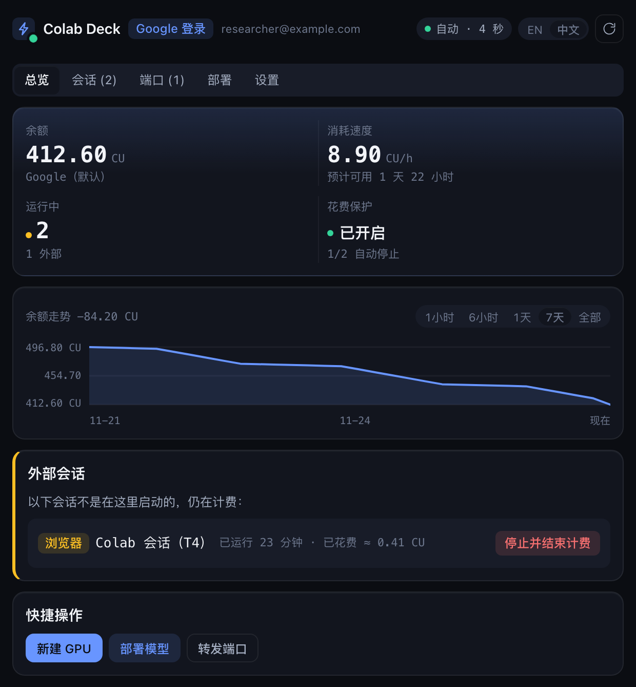

<div align="center">


# Colab Deck (`colab-mcp`)

**在侧边栏管理 Colab GPU，自带花费上限和自动停止。**

不用打开浏览器标签页，就能启动、查看和停止 Colab 会话，转发本地端口，并部署 GGUF 模型。自动停止与花费保护避免闲置 GPU 一夜耗光余额。

[主页](https://colabdeck.eatingdream.dev) · [English](README.md) | 简体中文 · [Releases](https://github.com/eatingDream-antigravity-plugins/colab-deck/releases) · [AI 指南](docs/ai-guide.md) · [`llms.txt`](llms.txt)

[](https://github.com/eatingDream-antigravity-plugins/colab-deck/actions/workflows/ci.yml)
[](https://github.com/eatingDream-antigravity-plugins/colab-deck/releases)

[](LICENSE)


<picture>
  <source media="(prefers-color-scheme: dark)" srcset="docs/images/colabdeck-overview-dark-zh.png">
  <source media="(prefers-color-scheme: light)" srcset="docs/images/colabdeck-overview-light-zh.png">
  
</picture>

</div>

## 适合你吗？

- **适合使用 Colab Deck**：你通过官方 `google-colab-cli` 使用 Colab Pro/Pro+ GPU（`T4`/`L4`/`G4`/`A100`/`H100`）或 TPU，希望在 Antigravity 中实时查看算力消耗、给实例加上双层自动停机守卫、本地转发 SSH 端口或一键部署 Hugging Face GGUF 模型。
- **不需要安装**：如果你只是偶尔在浏览器网页里跑免费版 Notebook，或者没有安装官方 `colab` CLI，直接用网页端更省事。

## 为什么选择 Colab Deck

- **再也不怕忘关 GPU 烧算力**：虚拟机端独立看门狗（硬截止时间 + 空闲自动停机，合盖离线依然生效）搭配主机端花费上限与余额底线守卫，并支持一键清理在浏览器中启动的外部实例。
- **精准抽卡显存与多账号隔离**：按需申请 CPU/GPU/TPU，支持 `min_vram_mib` 自动重试（例如确保拿到 80 GB A100），同时支持 ADC 与多账号 OAuth2 实时余额及燃烧速率监控。
- **安全独占的本地 SSH 端口转发**：将远端服务直接映射到 `127.0.0.1`，不改写 `~/.ssh/config`，禁止占用 VM 保留端口 `8080`，拒绝盲目重连导致静默新开计费实例。
- **一键部署 GGUF 推理服务**：在面板内直接搜索 Hugging Face GGUF 模型、提前估算各卡显存量化适配度，一键在 Colab GPU 上拉起 `llama.cpp` 并转发本地 `/v1` 接口与实时日志。
- **零计费演示模式**：随时用 `colab-mcp serve --mock` 在本地零花费完整体验所有交互流程。

## 快速开始

需要本机 `PATH` 中已安装官方 Google Colab CLI（`colab`，或通过 `COLAB_MCP_COLAB_BIN` 指定）。

```sh
curl -fsSL https://raw.githubusercontent.com/eatingDream-antigravity-plugins/colab-deck/main/scripts/install.sh | sh
```

<sub>自动从 GitHub Releases 下载对应平台预编译二进制（macOS Apple Silicon / Intel、Linux x86_64）、校验 SHA-256 摘要并安装到 <code>~/.gemini/config/plugins/colab-mcp</code>。如需源码编译，克隆仓库后运行 <code>./scripts/install.sh --from-source</code>。在 Antigravity 内安装时会自动通过 <code>RefreshMcpServers</code> 热重载 MCP 服务（传入 <code>--no-reload</code> 可跳过；在 Antigravity 外部可传 <code>--reload</code> 通过 <code>agy</code> 切换重载）。随时可执行 <code>curl -fsSL https://raw.githubusercontent.com/eatingDream-antigravity-plugins/colab-deck/main/scripts/install.sh | sh -s -- --uninstall</code> 卸载。</sub>

重载 Antigravity 即可打开 **Colab Deck**，或先用零计费演示模式体验：

```sh
~/.gemini/config/plugins/colab-mcp/bin/colab-mcp serve --mock
```

## 给 AI Agent 的文档

全部 CLI 参数、环境变量、MCP 工具 Schema 与成本安全规范均整理在 Agent 文档中：

```sh
npx skills add eatingDream-antigravity-plugins/colab-deck
```

- **便携 Agent Skill**：[`skills/colab-panel/SKILL.md`](skills/colab-panel/SKILL.md)
- **完整 AI 指南与参考**：[`docs/ai-guide.md`](docs/ai-guide.md)
- **LLM 索引入口**：[`llms.txt`](llms.txt)

> 提示词示例：*「阅读 [`llms.txt`](llms.txt) 和 [`docs/ai-guide.md`](docs/ai-guide.md)，配置 `colab-mcp` 并在成本守卫保护下管理 Colab GPU 会话。」*

## 安全、隐私与免责声明

- **计费诚实原则**：关闭隧道或关闭面板**不会**停止 VM 计费；只有经后端确认的 `stop` 或 `reap_orphan` 才会结束计费，停机未确认时会保持 `PendingStop` 并自动重试校验。
- **最小权限边界**：MCP 工具无法修改本机 `colab` 可执行文件路径；插件脚本**仅**在远端 Colab VM 上运行；密钥仅驻留内存并在日志与快照中自动脱敏。
- **零计费测试护栏**：单元测试与集成测试在编译期及运行期双重拒绝真实子进程执行，`cargo test` 绝不会调用真实 `colab` 或消耗算力单元。
- **Google Colab 服务条款免责声明**：本项目为独立开源工具，与 Google 无隶属关系。使用前请自行确认符合 Google 服务条款及 Colab Pro/Pro+ 使用政策。

## 文档索引

- [AI Agent 指南与完整参考 (`docs/ai-guide.md`)](docs/ai-guide.md) — MCP 工具、CLI 参数、环境变量与守卫流程
- [便携 Agent Skill (`skills/colab-panel/SKILL.md`)](skills/colab-panel/SKILL.md) · [LLM 索引 (`llms.txt`)](llms.txt)
- [安全策略](SECURITY.md) · [贡献指南](CONTRIBUTING.md) · [第三方声明](THIRD_PARTY_NOTICES.md)

## Antigravity 插件套件

属于 [Antigravity 插件套件](https://github.com/eatingDream-antigravity-plugins)：[Context Radar](https://github.com/eatingDream-antigravity-plugins/context-radar) · [Clam Guard](https://github.com/eatingDream-antigravity-plugins/clam-guard) · [Remote Cast](https://github.com/eatingDream-antigravity-plugins/remote-cast) · **Colab Deck** · [Panel Kit](https://github.com/eatingDream-antigravity-plugins/panel-kit)

## 致谢与许可证

本项目受 [scarletkc/colab-playground](https://github.com/scarletkc/colab-playground)（`Copyright (c) 2026 ScarletKc`，MIT 协议）启发并复用了其部分 VM 看门狗与插件清单设计。完整署名与许可证原文见 [THIRD_PARTY_NOTICES.md](THIRD_PARTY_NOTICES.md)。

基于 [MIT License](LICENSE) 开源。
